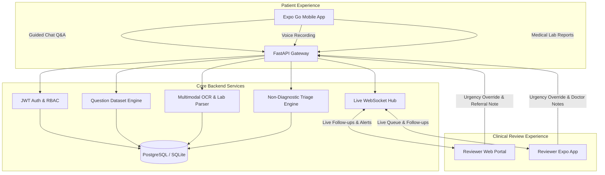

# Triage-Bot: Privacy-First, Human-in-the-Loop Healthcare Triage Assistant

[](https://fastapi.tiangolo.com/)
[](https://expo.dev/)
[](https://reactjs.org/)
[](https://www.postgresql.org/)
[](https://www.docker.com/)
[](#safety--responsible-ai-guardrails)

> **Official Disclaimer:** This software is an educational prototype and clinical decision-support tool. **It is strictly non-diagnostic.** It organizes patient symptoms, extracts diagnostic data via OCR, and highlights urgency signals for qualified healthcare workers (doctors, nurses, medical officers). **It does not prescribe treatment or replace clinical evaluation by a qualified medical professional.**

---

## 🏥 Problem Statement & Context

In Indian government hospitals, Primary Health Centers (PHCs), industrial health units, campus clinics, and public health camps, high patient influx and specialist scarcity strain triage workflows. 

**Triage-Bot** bridges this gap through a multimodal, privacy-first intake pipeline:
1. **Patient Mobile App (Expo Go)**: Bilingual (English/Hindi) guided chat with one-by-one adaptive questions, voice input, and medical report upload (PDF/Photos).
2. **Reviewer Mobile App (Expo Go)**: Portable clinical review queue for triage nurses and doctors on duty.
3. **Reviewer Web Portal (Browser)**: High-resolution clinical triage cockpit with AI summaries, OCR parameter tables, missing clinical information checklists, live chat follow-ups, and 1-click India-standard referral slips.
4. **Backend Engine (FastAPI & PostgreSQL)**: Clinical rule-engine + LLM synthesis, automated OCR parsing of pathology/radiology documents, PII de-identification, and live WebSockets.

---

## 📐 Architecture & Tech Stack



- **Mobile Application**: React Native (Expo SDK, compatible with Expo Go on physical iOS and Android devices).
- **Reviewer Web Application**: React 19 + Tailwind CSS + Lucide Icons + Vite (ultra-fast build and zero latency).
- **Backend API**: Python 3.11/3.13 + FastAPI + SQLAlchemy + WebSockets.
- **Database**: PostgreSQL (containerized) with automated SQLite fallback for instant zero-dependency local runs.
- **Multimodal OCR**: digital PDF text extraction plus Tesseract OCR for report photos and scanned PDFs, followed by clinical laboratory value extraction.
- **Security & Privacy**: Separate Patient/Reviewer JWT authentication, client-side PII masking, cryptographic audit trails.
- **Containerization**: Full `docker-compose.yml` for PostgreSQL, FastAPI backend, and Reviewer Web.

### Frontend–backend connection files

The frontends are written in JavaScript and connect to the Python FastAPI backend using HTTP requests with JSON (and multipart form data for uploads). WebSockets carry live case and reviewer updates.

- **Reviewer web API client**: `reviewer-web/src/api.js` — sends API requests from the web portal.
- **Patient and reviewer mobile API client**: `mobile/src/api/client.js` — sends API requests from the Expo app.
- **Backend app and route registration**: `backend/app/main.py` — creates the FastAPI app and registers its routers.
- **Backend API routes**: `backend/app/routers/` — `auth_router.py`, `cases_router.py`, `questions_router.py`, `upload_router.py`, and `websocket_router.py` define the HTTP and WebSocket endpoints.

The reviewer web and mobile apps use the same backend routes. See the [API call flow](#api-call-flow-when-each-endpoint-is-used) below for the endpoints and when the apps call them.

---

## 🎯 Pre-Configured Demo Accounts (Ready to Test)

Use any of these pre-seeded synthetic test personas:

### 👤 Patients (Use in Mobile App or Web)
| Patient ID | Password | Patient Name | Scenario | Clinical Presentation |
|---|---|---|---|---|
| `PAT-1001` | `patient123` | Aarav Sharma (28y/M) | Campus Fever | Acute High Fever (103°F), Dengue NS1 (+), Platelets 42k (Critical Low) |
| `PAT-1002` | `patient123` | Sunita Devi (45y/F) | Chronic Care | Type-2 Diabetes, FBS 218 mg/dL, HbA1c 10.4%, Early Nephropathy |
| `PAT-1003` | `patient123` | Ramesh Patel (38y/M) | Occupational Health | Factory Acid Fumes Inhalation, Severe Choking & Wheezing |
| `PAT-1004` | `patient123` | Pooja Verma (24y/F) | Maternal Health | 32 Weeks Primigravida, Severe Headache & Facial Edema (Pre-eclampsia Risk) |
| `PAT-1005` | `patient123` | Vikram Singh (52y/M) | General OPD | Acute Chest Heaviness, Dyspnea on Exertion |

### 🩺 Reviewers & Clinicians (Use in Reviewer Web or Reviewer Mobile)
| Reviewer ID | Password | Clinician Name | Role / Unit |
|---|---|---|---|
| `REV-DR-RAO` | `doctor123` | Dr. Ananya Rao (MD) | Casualty / Emergency Medicine Officer |
| `REV-DR-MEHTA` | `doctor123` | Dr. Rajesh Mehta (MBBS) | Primary Health Center (PHC) Medical Officer |
| `REV-NURSE-PRIYA` | `doctor123` | Sister Priya Nair | Senior Triage Nurse |

### Create patient or reviewer accounts from PowerShell

Start the backend first, then open a PowerShell terminal. Send a registration request to `POST http://localhost:8000/api/auth/register`. Choose a unique `user_id` and your own password.

Create a patient account:

```powershell
$body = @{
  user_id = "PAT-2001"
  password = "choose-a-password"
  role = "patient"
  full_name = "New Patient"
  age = 30
  gender = "Female"
  preferred_language = "en"
} | ConvertTo-Json

Invoke-RestMethod `
  -Uri "http://localhost:8000/api/auth/register" `
  -Method Post `
  -ContentType "application/json" `
  -Body $body
```

Create a reviewer account by setting `role` to `reviewer` and using a different ID:

```powershell
$body = @{
  user_id = "REV-2001"
  password = "choose-a-password"
  role = "reviewer"
  full_name = "Dr. Example"
  preferred_language = "en"
} | ConvertTo-Json

Invoke-RestMethod `
  -Uri "http://localhost:8000/api/auth/register" `
  -Method Post `
  -ContentType "application/json" `
  -Body $body
```

After registration, sign in from the matching Patient or Reviewer tab with the new ID and password. The backend stores a password hash, not the plain-text password. If the backend is running on another computer, replace `localhost` with that computer's IP address.

---

## 🚀 How to Run the Prototype

### Method 1: Local Launch

#### Step 1: Start Backend (Port 8000)
```powershell
# From project root:
python -m pip install -r backend/requirements.txt
.\run_backend.bat
# Or:
cd backend
python -m uvicorn app.main:app --host 0.0.0.0 --port 8000 --reload
```
*Photo and scanned-PDF OCR also requires the Tesseract OCR program. Install it on the backend computer and make sure `tesseract.exe` is on `PATH`, or set `TESSERACT_CMD` to its full path.*
*Voice transcription runs locally on the backend computer with faster-whisper. On first startup, the backend downloads the selected multilingual model (`base` by default) in the background; wait for `Local Whisper model is ready` before trying voice. Other API features remain available while it loads. Audio is not sent to an external transcription service.*
*Backend initializes SQLite database and seeds synthetic cases automatically.*
*Swagger UI docs available at:* `http://localhost:8000/docs`

### API keys and configuration

The local demo does not require a third-party API key. Gemini is optional; the application has a local rule-based triage summary when Gemini is not configured. OCR and voice transcription run locally and do not need cloud API keys.

Backend settings are read from `backend/.env` (create this file if needed) or the process environment:

| Setting | Required? | Purpose / where to get it |
|---|---|---|
| `GEMINI_API_KEY` | No | Optional Google Gemini key. Create one in [Google AI Studio](https://aistudio.google.com/apikey). Used by the backend only to optionally augment triage summaries. Leave blank to use the local rule-based summary. Do not put this key in the mobile app or reviewer web app. |
| `SECRET_KEY` | For deployed/non-demo use | Signs backend JWT login tokens. There is a development default in the source; replace it with a long random secret that you generate and keep private. It is not obtained from an API provider. |
| `DATABASE_URL` | No for local SQLite | Database connection string. Defaults to a local SQLite database. Docker Compose supplies a PostgreSQL URL. This is connection configuration, not an API key. |
| `TESSERACT_CMD` | No | Optional full path to `tesseract.exe` if Tesseract is not on `PATH`; needed only for image/scanned-PDF OCR. |
| `WHISPER_MODEL_SIZE` | No | Local faster-whisper model size (default `base`); not an API key. The model is downloaded on first backend startup. |
| `VITE_API_URL` | No | Reviewer web build setting for the backend URL; defaults to `http://localhost:8000`. Not a key. |

Example `backend/.env` for a local run (keep real secrets out of Git):

```dotenv
SECRET_KEY=replace-with-a-long-random-private-value
GEMINI_API_KEY=
# DATABASE_URL=sqlite+aiosqlite:///./triage.db
# TESSERACT_CMD=C:\\Program Files\\Tesseract-OCR\\tesseract.exe
# WHISPER_MODEL_SIZE=base
```

Generate a random secret locally with Python: `python -c "import secrets; print(secrets.token_urlsafe(48))"`. Put the result in `SECRET_KEY`. If you enable Gemini, copy the key from AI Studio into `GEMINI_API_KEY`; never commit `backend/.env` or share the key in screenshots/logs. Gemini requests may be subject to Google's current quotas and billing terms.

The mobile app has no provider API key. It sends requests to the backend URL set in its server settings (the default is in `mobile/src/api/client.js`). The reviewer web app also calls the backend directly; `VITE_API_URL` changes its base URL.

### API call flow: when each endpoint is used

All REST endpoints below are served by the FastAPI backend at `http://localhost:8000` (replace the host for a phone or deployed server). After login, the apps send the returned JWT as `Authorization: Bearer <token>` on protected requests. Use `/docs` for request/response schemas.

| When | Request | What it does |
|---|---|---|
| App opens login | `GET /api/auth/demo-accounts` | Loads synthetic demo IDs/passwords for the login screen. |
| Patient or reviewer signs in | `POST /api/auth/patient-login` or `POST /api/auth/reviewer-login` | Checks credentials and returns a JWT used on later protected requests. |
| Profile is requested | `GET /api/auth/me` | Returns the logged-in user profile (used by reviewer web). |
| Patient opens case history / reviewer opens queue | `GET /api/cases` | Lists the caller's cases for a patient, or the review queue for a reviewer. The patient app refreshes this list periodically. |
| Patient starts a triage | `POST /api/cases` | Creates a case using the selected scenario and consent. |
| Chat opens or resumes | `GET /api/cases/{case_id}` | Loads case details, messages, documents, and referral information. Patient chat refreshes this while open. |
| Guided intake needs the next prompt | `GET /api/questions/next-question?case_id={id}` | Finds the next unanswered question for the case scenario. |
| Patient sends an answer | `POST /api/cases/answer` | Saves the answer and recalculates the rule-based triage summary. If `GEMINI_API_KEY` is set, the backend also attempts its optional Gemini request at this point. |
| Patient uploads a report | `POST /api/upload/report` (multipart: `case_id`, `file`) | Saves a PDF/image, runs local OCR and lab parsing, updates the summary, then notifies connected reviewer clients. If Gemini is configured, summary generation also attempts Gemini. |
| Patient records a voice response | `POST /api/upload/voice` (multipart: `case_id`, `language`, `file`) | Transcribes audio using the local faster-whisper model; the patient reviews and submits the resulting text separately via `/api/cases/answer`. |
| Patient/reviewer loads sample report choices | `GET /api/upload/samples` | Lists built-in synthetic sample reports. |
| App retrieves an uploaded/sample file | `GET /api/upload/file/{filename}` | Serves the file. |
| Reviewer asks patient a question | `POST /api/cases/{case_id}/follow-up` | Adds a reviewer follow-up to the patient conversation and sends a live update. |
| Reviewer updates case or finalizes referral | `PATCH /api/cases/{case_id}/review` | Saves reviewer notes/status and, when a referral destination is supplied, marks the case `REFERRED` and creates the handoff note. |
| Reviewer checks case history | `GET /api/cases/{case_id}/audit-logs` | Returns audit events for that case. |
| Apps need scenario metadata | `GET /api/questions/scenarios` | Lists available triage scenarios. `GET /api/questions/protocol/{scenario}` returns a scenario protocol. |
| Reviewer web listens for new/changed work | `WS /ws/reviewer/notifications` | WebSocket feed for reviewer notifications. |
| App listens for a case update | `WS /ws/case/{case_id}` | WebSocket channel for case events. Some screens also poll the case REST endpoint. |
| Health check / service discovery | `GET /health` or `GET /` | Reports backend health/status or lists API base paths. |

The reviewer mobile app and reviewer web portal use the same backend routes. Login is the only place the user enters their password; subsequent protected REST requests use the JWT until it expires or the app logs out.

#### Step 2: Start Reviewer Web Portal (Port 3000)
```powershell
# Open a new terminal:
.\run_web.bat
# Or:
cd reviewer-web
npm run dev
```
*Open `http://localhost:3000` in your browser.*

#### Step 3: Start Mobile App on Expo Go
```powershell
# Open a new terminal:
.\run_mobile.bat
# Or:
cd mobile
npx expo start
```
1. Install **Expo Go** from the App Store (iOS) or Google Play Store (Android).
2. Scan the terminal QR code using your phone camera (iOS) or the Expo Go app (Android).
3. Ensure your phone and PC are connected to the same Wi-Fi network. *(Default IP `http://10.161.35.182:8000` is pre-configured, or tap the gear icon in the app to adjust).*

---

### Method 2: Docker Compose

Before the first Docker Compose run, copy the root `.env.example` to `.env` and replace the `POSTGRES_PASSWORD` and `SECRET_KEY` placeholders with private random values. Keep `.env` out of Git. On PowerShell:

```powershell
Copy-Item .env.example .env
```

Then edit `.env` and start the services:

```bash
docker-compose up --build
```
- PostgreSQL: `localhost:5432`
- FastAPI Backend: `http://localhost:8000`
- Reviewer Web: `http://localhost:3000`

---

## 🛡️ Safety & Responsible AI Guardrails

1. **Non-Diagnostic Constraint**: System prompts, rule engines, and summaries explicitly forbid prescribing medications or giving clinical diagnoses. All outputs are prefixed with safety disclaimers.
2. **Missing Information Detection**: AI inspects responses against standardized clinical protocols and generates a specific checklist of omitted items (e.g., vital signs, allergy history).
3. **Reviewer-in-the-Loop Escalation**: Every AI recommendation requires verification by the medical officer. Reviewers can override urgency scores, adjust queues, and approve follow-up questions.
4. **Targeted Follow-Ups**: Reviewers can send questions back to the patient's phone. Patient answers immediately update the case and re-calculate the clinical summary.
5. **PII Masking & Privacy**: Identifiers (phone numbers, addresses) are stripped before synthesis. Immutable audit logs track every document upload and reviewer access event.
6. **India-Standard Referral Handoff**: 1-click generator creates formatted referral slips for transfer to Civil Hospitals, Emergency Resuscitation Wards, or Specialty OPDs.

---

## 🧪 Testing the Multimodal Features

1. **OCR Medical Report Upload**:
   - In the mobile chat, navigate to question 7 or tap the clip icon.
   - Choose a PDF or photo, or tap **"Attach Sample CBC / Dengue Lab Report (1-Click Test)"**.
   - Watch the raw report get processed into structured tabular lab parameters (`Platelet Count: 42,000 /mcL`, `Dengue NS1 Reactive`) on both the mobile view and the web reviewer dashboard!
2. **Voice Input / Speech-to-Text**:
   - Install backend requirements, start the backend, and wait for the local Whisper model download to finish before recording voice.
   - Tap the microphone, confirm the transcription notice, and allow microphone access.
   - Tap the microphone again to stop. Review or edit the transcript in the chat field, then tap Send.
3. **Real-Time Follow-Up Loop**:
   - On the Reviewer Web dashboard, select a case and type a follow-up question or click one of the suggested missing information prompts.
   - The question appears in the patient's mobile app chat.
   - Patient answers, and the reviewer dashboard refreshes with the updated clinical synthesis!

---

## 📊 Evaluation Criteria Mapping

| Criteria | Weight | Implementation Details |
|---|---|---|
| **Safety-First Triage Workflow** | 20% | Strict non-diagnostic guardrails; Manchester & ESI-inspired urgency tiers; emergency red-flag screening. |
| **Extraction & Summarization Quality** | 20% | Structured clinical timeline, pertinent negatives, urgency rationale, and missing clinical info checklists. |
| **Multimodal Capability** | 15% | Digital PDF/photo OCR lab extraction, voice input transcription, and structured lab ranges table. |
| **India-Wide Relevance & Accessibility** | 15% | Protocols for Campus Fever (Dengue), Industrial Hazards, Maternal Antenatal High-Risk, and Chronic Care; English & Hindi bilingual toggle. |
| **Human-Review & Escalation Logic** | 15% | Two-way patient-doctor follow-up loop; physician override; India-standard printable referral slip. |
| **Privacy & Responsible AI** | 10% | Patient consent tracking, PII redaction, HIPAA/ABDM-inspired audit trail, non-diagnostic disclaimers. |
| **Demo Quality** | 5% | 5 pre-loaded realistic Indian patient scenarios, 3 clinician roles, 1-click test credentials, and instant launch scripts. |

